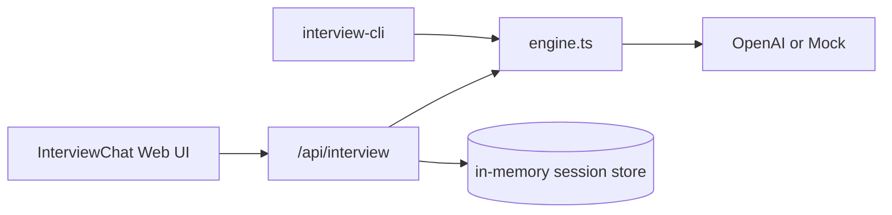

# アーキテクチャ

## Phase 1 構成

## 主要モジュール

| パス | 役割 |
|------|------|
| `src/lib/interview/engine.ts` | セッション状態、ステージ進行、安全フォールバック |
| `src/lib/interview/schemas.ts` | Zod（API 入力 + LLM 出力） |
| `src/lib/interview/providers/*` | OpenAI / mock |
| `src/lib/interview/safety.ts` | 誘導・診断的表現のヒューリスティクス |
| `src/app/api/interview/route.ts` | REST エントリポイント |

## 今後（Phase 2–4）

- Supabase PostgreSQL：セッション、発言 ID、同意、公開状態
- Supabase Storage：音声・WAV・画像
- FFmpeg バッチ：オフラインで Pocket 2 映像と DJI 内部 WAV を同期
- Playwright：E2E（音声 UI、管理画面）

## 環境変数

`INTERVIEW_PROVIDER`, `OPENAI_API_KEY`, `OPENAI_MODEL` — 詳細は `.env.example`。
